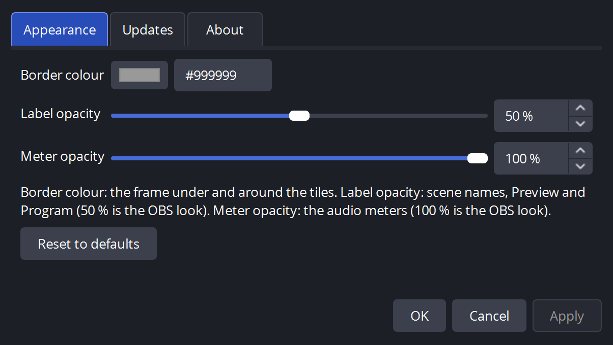
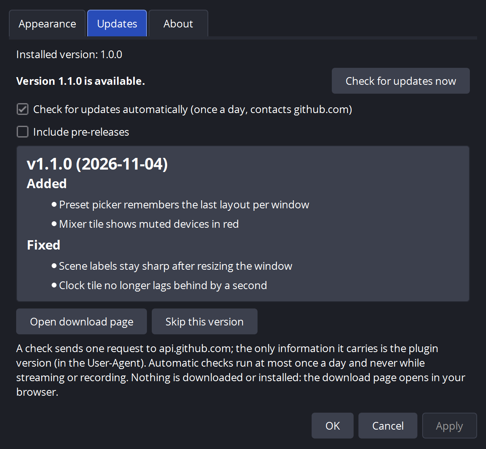

# 🖥️ Multiview Pro for OBS

**A broadcast-style multiview for OBS Studio: every scene live, audio meters, and ON AIR / REC / clock / mixer tiles in the same grid.**

**Un multiview da regia per OBS Studio: tutte le scene in diretta, meter audio e riquadri IN ONDA / REC / orologio / mixer nella stessa griglia.**

[English](#english) · [Italiano](#italiano)

[](https://github.com/angeloruggieridj/obs-multiview-pro/actions/workflows/build.yml)
[](https://github.com/angeloruggieridj/obs-multiview-pro/releases/latest)


<p align="center"></p>

<p align="center">
  
  
</p>

<p align="center">
  
  
</p>

*Demo content and demo status values. Top: 8 tiles + status. Middle: scenes only (native look) and 24 scenes. Bottom: settings and updates.*

---

## English

**Contents:** [Features](#features) · [Presets](#presets) · [Install](#install) · [Use](#use) · [Settings and updates](#settings-and-updates) · [Limits](#limits) · [Build](#build-from-source) · [License](#license)

### Features

- **Native look**: same tiles, outlines, safe areas and scene names as the built-in multiview; every scene drawn each frame.
- **Audio**: stereo meters with dB scale on program and preview; thin L/R meters on every scene tile (the loudest audio source of the scene); a mixer tile with the audio sources of the program scene (and of the preview scene in studio mode) and the global audio devices.
- **Status tiles**: ON AIR (time, bitrate, dropped frames, connection, service), REC (time, file, size), clock.
- **Editing in place**: click, double-click, drag to swap, right-click menu, click a tile name to pick its scene.
- **Remembers** preset, options and tile assignments per window and per scene collection.
- **Light**: nothing allocated per frame in the draw path; meters off means no audio work.
- **Languages**: English and Italian, following the OBS language.

### Presets

| Family | Scenes | Tiles |
| --- | --- | --- |
| Scenes only | 4 · 8 · 16 · 24 · 32 | program, preview, scenes (8 and 24 identical to native) |
| With status | 4 · 12 · 20 · 28 | program, preview, scenes, ON AIR, REC, clock, mixer |

<p align="center"></p>

### Install

Download the zip for your system from [Releases](https://github.com/angeloruggieridj/obs-multiview-pro/releases) and unzip it into the plugins folder. Close OBS first. Needs OBS Studio 32.1 or newer.

| OS | Zip | Unzip into |
| --- | --- | --- |
| Windows | `…-windows-x64.zip` | `C:\ProgramData\obs-studio\plugins\` |
| macOS | `…-macos-universal.zip` | `~/Library/Application Support/obs-studio/plugins/` |
| Linux | `…-ubuntu-24.04-x86_64.zip` | `~/.config/obs-studio/plugins/` |

`SHA256SUMS.txt` lists the checksums. The binaries are not signed: on macOS allow the plugin in *System Settings → Privacy & Security*, or run `xattr -dr com.apple.quarantine obs-multiview-pro.plugin`. The Linux zip is for Ubuntu 24.04 with the OBS Studio PPA (not Flatpak or Snap).

### Use

Open **Tools → Multiview** (several windows are allowed), then right-click the window.

| Action | Result |
| --- | --- |
| Click a scene tile | Studio mode: set preview. Otherwise: set program |
| Double-click (studio mode) | Preview, then transition to program |
| Drag a tile onto another | Swap the two scenes |
| Right-click | Layout, assign/remove scene, meters, meters on scene tiles, safe areas, always on top, settings |
| Click a tile name | Choose the scene for that tile |

Scenes with *Show in Multiview* off are skipped, like the native multiview.

### Settings and updates

**Tools → Multiview Settings...** (or right-click → *Settings...*):

- **Appearance**: border colour (the frame under the tiles), label opacity (default 50 %, 0 hides labels and the click-on-name menu), meter opacity (default 100 %), audio meters on the scene tiles (default on, shown where the window's meters are on), multiview windows always on top (default off; the settings dialog stays above them). Changes show live in every window.
- **Updates**: *Check for updates* now, or automatically once a day (on by default, never while streaming or recording). A newer version shows its change log and *Open download page*; *Skip this version* stops the reminder. An automatic check never opens a window: it adds a log line and an *Update available* menu entry.
- **Privacy**: a check is one HTTPS request to `api.github.com`, sending only the plugin version in the User-Agent (GitHub sees your IP, as for any connection). Nothing is downloaded or installed. To turn it off clear *Check for updates automatically*. Details in [SECURITY.md](SECURITY.md).

### Limits

- Runtime-tested on **Windows 11 with OBS 32.2** only. macOS and Linux builds compile and pass the unit tests on CI but have never been run: reports are welcome.
- Linux under Wayland: the window stays empty (needs Qt 6.9, the build uses 6.4). Start OBS with `QT_QPA_PLATFORM=xcb`.
- Meters: program follows the program mix (track 1); preview and scene tiles show the loudest audio source of their scene (post-fader; the audio sources the OBS mixer lists for a scene, plus those of nested scenes and groups). A scene has no audio of its own: sources that only play on air (media set to *Restart when activated*) stay silent off air. At most 128 metered sources per window (mixer, preview, then tiles in order); the rest are noted in the OBS log.
- Mixer tile: at most 7 sources beside PGM (global devices first, then the program scene, then the preview scene); the rest are left out and noted in the OBS log.
- *CACHE* shows the output congestion (OBS has no cache indicator). No NDI state tile.
- Each open multiview window meters its sources on its own (one volmeter per source per window); a hidden or minimised window does no audio work.
- With *always on top*, OBS's own dialogs (properties, settings) can open behind the multiview, as with OBS's projectors kept on top.

### Build from source

```
cmake --preset windows-x64        # or macos | ubuntu-x86_64
cmake --build --preset windows-x64
ctest --test-dir build_x64 -C RelWithDebInfo
```

CMake downloads OBS, its dependencies and Qt on Windows and macOS. On Ubuntu install `libobs-dev`, `qt6-base-dev`, `qt6-base-private-dev` and `libcurl4-openssl-dev` first. More in [docs/ci-notes.md](docs/ci-notes.md) and [docs/dev-environment-notes.md](docs/dev-environment-notes.md). To add a language see [CONTRIBUTING.md](CONTRIBUTING.md).

### License

GPL-2.0-or-later, see [LICENSE](LICENSE).

[Issues](https://github.com/angeloruggieridj/obs-multiview-pro/issues) · [Security](SECURITY.md) · [Changelog](CHANGELOG.md) · [Contributing](CONTRIBUTING.md)

---

## Italiano

**Indice:** [Funzionalità](#funzionalità) · [Preset](#preset) · [Installazione](#installazione) · [Uso](#uso) · [Impostazioni e aggiornamenti](#impostazioni-e-aggiornamenti) · [Limiti](#limiti) · [Compilare](#compilare-dai-sorgenti) · [Licenza](#licenza)

### Funzionalità

- **Aspetto nativo**: stessi riquadri, contorni, margini di sicurezza e nomi delle scene della vista multipla di OBS; ogni scena è aggiornata a ogni frame.
- **Audio**: meter stereo con scala in dB su programma e anteprima; meter sottili L/R su ogni riquadro scena (la sorgente audio più forte della scena); un riquadro mixer con le sorgenti audio della scena in programma (e di quella in anteprima in modalità studio) e i dispositivi audio globali.
- **Riquadri di stato**: IN ONDA (tempo, bitrate, frame persi, connessione, servizio), REC (tempo, file, dimensione), orologio.
- **Modifica sul posto**: clic, doppio clic, trascinamento per scambiare, menu col tasto destro, clic sul nome per scegliere la scena.
- **Ricorda** preset, opzioni e assegnazioni per finestra e per collezione di scene.
- **Leggero**: il disegno non alloca memoria a ogni frame; con i meter spenti non c'è lavoro audio.
- **Lingue**: italiano e inglese, secondo la lingua di OBS.

### Preset

| Famiglia | Scene | Riquadri |
| --- | --- | --- |
| Solo scene | 4 · 8 · 16 · 24 · 32 | programma, anteprima, scene (8 e 24 identici a quelli di OBS) |
| Con stato | 4 · 12 · 20 · 28 | programma, anteprima, scene, IN ONDA, REC, orologio, mixer |

### Installazione

Scarica lo zip per il tuo sistema da [Releases](https://github.com/angeloruggieridj/obs-multiview-pro/releases) ed estrailo nella cartella dei plugin, a OBS chiuso. Serve OBS Studio 32.1 o successivo.

| Sistema | Zip | Estrai in |
| --- | --- | --- |
| Windows | `…-windows-x64.zip` | `C:\ProgramData\obs-studio\plugins\` |
| macOS | `…-macos-universal.zip` | `~/Library/Application Support/obs-studio/plugins/` |
| Linux | `…-ubuntu-24.04-x86_64.zip` | `~/.config/obs-studio/plugins/` |

`SHA256SUMS.txt` contiene i checksum. I binari non sono firmati: su macOS consenti il plugin in *Impostazioni di Sistema → Privacy e sicurezza*, oppure esegui `xattr -dr com.apple.quarantine obs-multiview-pro.plugin`. Lo zip per Linux è per Ubuntu 24.04 con il PPA di OBS Studio (non Flatpak né Snap).

### Uso

Apri **Strumenti → Multiview** (puoi aprire più finestre), poi clicca col tasto destro sulla finestra.

| Azione | Risultato |
| --- | --- |
| Clic su un riquadro scena | Modalità studio: imposta l'anteprima. Altrimenti: imposta il programma |
| Doppio clic (modalità studio) | Anteprima, poi transizione al programma |
| Trascina un riquadro su un altro | Scambia le due scene |
| Tasto destro | Layout, assegna/rimuovi scena, meter, meter sui riquadri delle scene, margini di sicurezza, sempre in primo piano, impostazioni |
| Clic sul nome di un riquadro | Sceglie la scena di quel riquadro |

Le scene con *Mostra in Vista multipla* disattivato vengono saltate, come nella vista multipla di OBS.

### Impostazioni e aggiornamenti

**Strumenti → Impostazioni Multiview…** (o tasto destro → *Impostazioni…*):

- **Aspetto**: colore del bordo (la cornice sotto i riquadri), opacità delle etichette (predefinita 50%; con 0 le etichette spariscono e non si può più cliccare sul nome), opacità dei meter (predefinita 100%), meter audio sui riquadri delle scene (attivi per impostazione predefinita, visibili dove i meter della finestra sono accesi), finestre Multiview sempre in primo piano (disattivate per impostazione predefinita; la finestra delle impostazioni resta sopra di loro). Le modifiche si vedono subito in tutte le finestre.
- **Aggiornamenti**: *Controlla aggiornamenti* subito, oppure in automatico una volta al giorno (attivo per impostazione predefinita, mai durante una diretta o una registrazione). Se c'è una versione nuova compaiono le novità e *Apri pagina di download*; *Salta questa versione* sospende l'avviso. Il controllo automatico non apre mai finestre: scrive una riga nel log e aggiunge la voce *Aggiornamento disponibile* al menu.
- **Privacy**: ogni controllo è una sola richiesta HTTPS ad `api.github.com` che invia solo la versione del plugin nello User-Agent (GitHub vede il tuo IP, come in ogni connessione). Il plugin non scarica né installa nulla. Per disattivarlo togli la spunta a *Controlla gli aggiornamenti automaticamente*. Dettagli in [SECURITY.md](SECURITY.md).

### Limiti

- Provato in esecuzione solo su **Windows 11 con OBS 32.2**. Le build per macOS e Linux compilano e passano i test unitari in CI ma non sono mai state avviate: le segnalazioni sono benvenute.
- Linux con Wayland: la finestra resta vuota (serve Qt 6.9, la build usa la 6.4). Avvia OBS con `QT_QPA_PLATFORM=xcb`.
- Meter: il programma segue il mix del programma (traccia 1); l'anteprima e i riquadri scena mostrano la sorgente audio più forte della loro scena (dopo il fader; le sorgenti audio che il mixer di OBS elenca per una scena, più quelle delle scene annidate e dei gruppi). Una scena non ha audio proprio: le sorgenti che suonano solo in onda (file multimediali con *Riavvia la riproduzione quando la fonte torna attiva*) restano mute fuori onda. Al massimo 128 sorgenti con meter per finestra (mixer, anteprima, poi i riquadri in ordine); le altre sono segnalate nel log di OBS.
- Riquadro mixer: al massimo 7 sorgenti oltre a PGM (prima i dispositivi globali, poi la scena in programma, poi quella in anteprima); le altre restano fuori e il log di OBS lo segnala.
- *CACHE* mostra la congestione dell'uscita (OBS non ha un indicatore di cache). Nessun riquadro per lo stato NDI.
- Ogni finestra Multiview aperta misura le sue sorgenti per conto proprio (un volmeter per sorgente per finestra); una finestra nascosta o ridotta a icona non fa lavoro audio.
- Con *sempre in primo piano* le finestre di OBS (proprietà, impostazioni) possono aprirsi dietro la vista multipla, come con i proiettori di OBS tenuti in primo piano.

### Compilare dai sorgenti

```
cmake --preset windows-x64        # oppure macos | ubuntu-x86_64
cmake --build --preset windows-x64
ctest --test-dir build_x64 -C RelWithDebInfo
```

Su Windows e macOS CMake scarica OBS, le dipendenze e Qt. Su Ubuntu installa prima `libobs-dev`, `qt6-base-dev`, `qt6-base-private-dev` e `libcurl4-openssl-dev`. Altri dettagli in [docs/ci-notes.md](docs/ci-notes.md) e [docs/dev-environment-notes.md](docs/dev-environment-notes.md). Per aggiungere una lingua vedi [CONTRIBUTING.md](CONTRIBUTING.md).

### Licenza

GPL-2.0-or-later, vedi [LICENSE](LICENSE).

[Issues](https://github.com/angeloruggieridj/obs-multiview-pro/issues) · [Sicurezza](SECURITY.md) · [Changelog](CHANGELOG.md) · [Contribuire](CONTRIBUTING.md)
