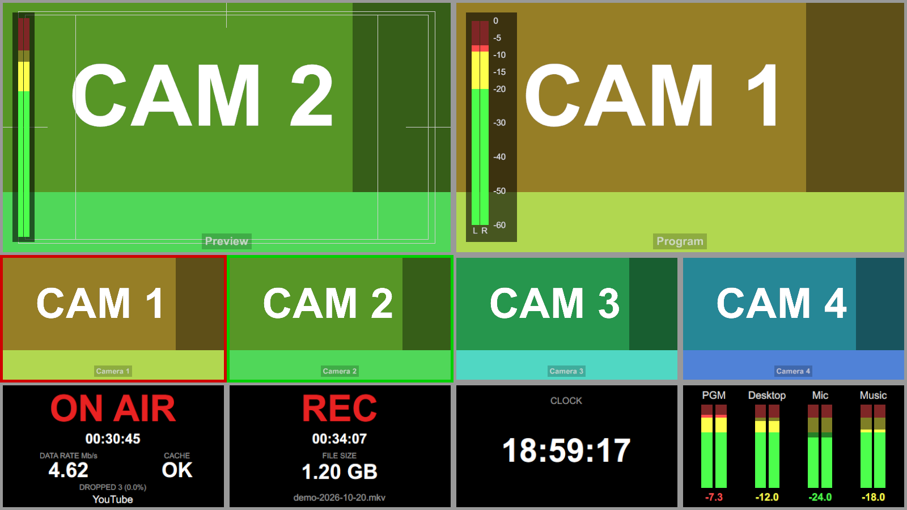
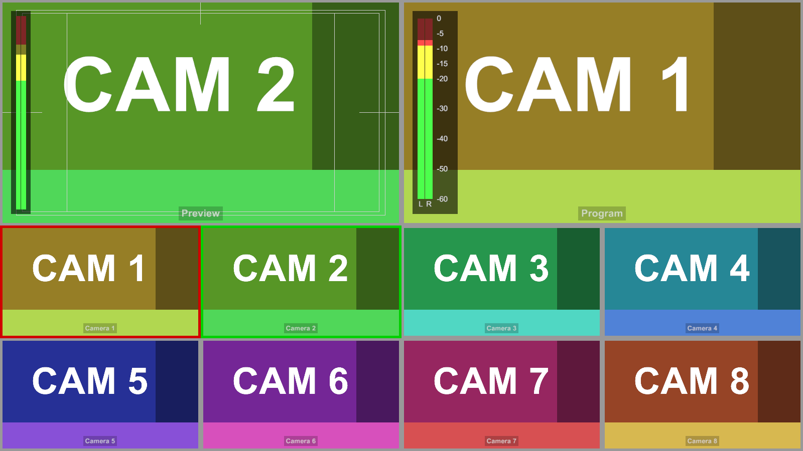
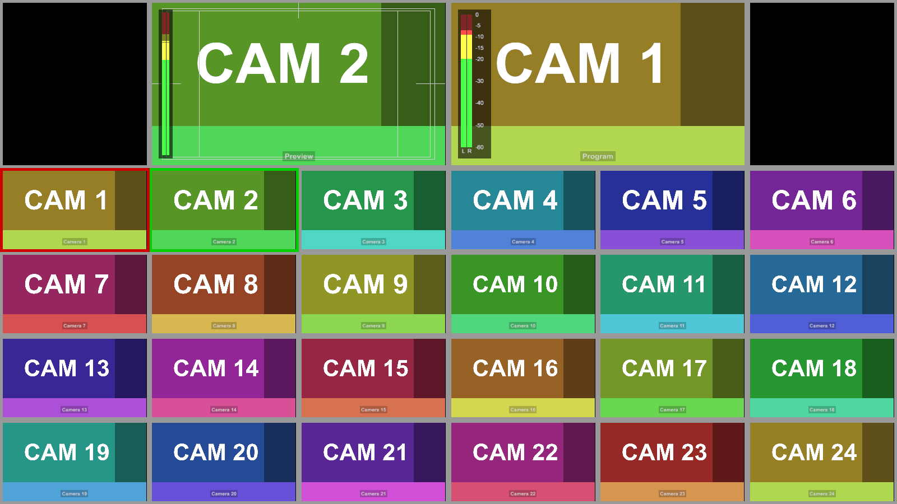
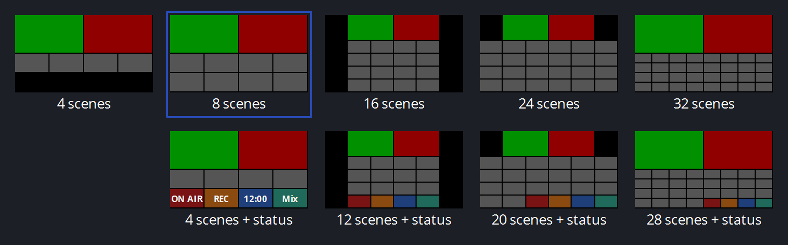

# 🖥️ Multiview Pro for OBS

**A broadcast-style multiview for OBS Studio: every scene live, program and preview with audio meters, and ON AIR / REC / clock / mixer tiles in the same grid.**

**Un multiview in stile regia per OBS Studio: tutte le scene in diretta, programma e anteprima con meter audio, e riquadri ON AIR / REC / orologio / mixer nella stessa griglia.**

[English](#english) · [Italiano](#italiano)

[](https://github.com/angeloruggieridj/obs-multiview-pro/actions/workflows/build.yml)


<p align="center"></p>

*Preset "8 tiles + status": 4 scenes, ON AIR, REC, clock and audio mixer. Demo content and demo status values.*

<p align="center">
  
  
</p>

*Left: scenes-only layout, same look as the native multiview. Right: 24 scenes.*

---

## English

**Contents:** [Why](#why) · [Features](#features) · [Presets](#presets) · [Install](#install) · [Getting started](#getting-started) · [Controls](#controls) · [Status](#status-and-limits) · [Build](#build-from-source) · [License](#license)

### Why

The native OBS multiview is fixed: 8 or 24 scenes, no audio meters, no clock, no live or recording state. Hardware switchers show all of that. This plugin opens its own multiview window that looks like the native one, then adds what a control room needs.

### Features

- **Native look.** Same tiles, colours, red program and green preview outlines, safe areas and scene names as the built-in multiview. Scenes are drawn every frame.
- **Presets.** 4, 8, 16, 24 and 32 scenes, or the same grids with four status tiles. Pick from thumbnails.
- **Audio meters.** Stereo meters with dB scale on program and preview, native colours and ballistics. A mixer tile lists the global audio devices.
- **ON AIR and REC tiles.** Big red state, elapsed time, bitrate, dropped frames and connection state, service name, recording file and size.
- **Clock tile.** Local time.
- **Editing in place.** Click to switch, drag tiles to swap, right-click to assign or remove a scene, click a tile name to pick another scene.
- **Settings.** Choose the border colour (the frame under and around the tiles), the label opacity and the meter opacity. Changes show live in every window.
- **Remembers everything.** Preset, options and tile assignments are saved per window and per scene collection.
- **Light.** The draw path does no allocation and the audio callbacks only write atomics. Meters off means no audio work at all.

### Presets

<p align="center"></p>

| Family | Sizes | Tiles |
| --- | --- | --- |
| Scenes only | 4 · 8 · 16 · 24 · 32 | program, preview, N scenes (8 and 24 identical to native) |
| With status | 4 · 12 · 20 · 28 scenes | program, preview, N scenes, ON AIR, REC, clock, mixer (same grids as 8 · 16 · 24 · 32) |

### Install

No release yet: the plugin is in alpha. Build it from source (below), or download the build artifacts of the latest successful run in the [Actions](https://github.com/angeloruggieridj/obs-multiview-pro/actions) tab.

| OS | Copy to |
| --- | --- |
| Windows | `C:\ProgramData\obs-studio\plugins\obs-multiview-pro\bin\64bit\obs-multiview-pro.dll` |
| macOS | `~/Library/Application Support/obs-studio/plugins/obs-multiview-pro.plugin` |
| Linux | `~/.config/obs-studio/plugins/obs-multiview-pro/bin/64bit/obs-multiview-pro.so` |

Close OBS before copying. Needs OBS Studio 32.1 or newer.

### Getting started

1. Open OBS and choose **Tools → Multiview**. A new window opens. You can open several.
2. Right-click the window → **Layout…** and pick a preset.
3. Optional: turn **Audio meters** and **Safe areas** on or off from the same menu.

### Controls

| Action | Result |
| --- | --- |
| Click a scene tile | Studio mode: set preview. Otherwise: set program |
| Double-click (studio mode) | Preview, then transition to program |
| Drag a tile onto another | Swap the two scenes |
| Right-click a tile | Assign, remove or add a scene; layout; meters; safe areas; settings |
| Click a tile name | Choose the scene for that tile |

Scenes with *Show in Multiview* off are skipped, like the native one.

**Settings.** Open **Tools → Multiview Settings...** or right-click a window → **Settings...**. *Border colour* is the frame under and around the tiles (default grey; the red program and green preview outlines do not change). *Label opacity* is the opacity of scene names, Preview and Program, 0–100 % (default 50 %, the native look; the label background follows it; 0 hides the labels and also removes the click-on-name scene menu). *Meter opacity* is the opacity of the audio meters, 0–100 % (default 100 %); every element fades on its own, so the contrast between lit and unlit parts drops at low values. The settings apply to all windows and are saved.

### Status and limits

Alpha. Tested on **Windows 11 with OBS 32.2** only. macOS and Linux builds run on CI but have not been tried yet.

- Wayland needs Qt 6.9 or newer. Older Qt: start OBS with `QT_QPA_PLATFORM=xcb`.
- Meters follow the program mix (track 1) and, for preview, the audio sources of the preview scene. Media sources set to *Restart when activated* stay silent off air, as in the OBS mixer. There are no meters on the other scene tiles yet.
- OBS has no cache indicator like hardware switchers: the connection state comes from the output congestion.
- If the window opens while streaming or recording, durations are derived from the output frame counter.
- No NDI state tile.

### Build from source

```
cmake --preset windows-x64        # macos | ubuntu-x86_64
cmake --build --preset windows-x64
ctest --test-dir build_x64 -C RelWithDebInfo
```

CMake downloads OBS, its dependencies and Qt on Windows and macOS. On Ubuntu install `libobs-dev`, `qt6-base-dev` and `qt6-base-private-dev` first. See [docs/ci-notes.md](docs/ci-notes.md) and [docs/dev-environment-notes.md](docs/dev-environment-notes.md).

### License

GPL-2.0-or-later, see [LICENSE](LICENSE).

[Issues](https://github.com/angeloruggieridj/obs-multiview-pro/issues) · [Security](SECURITY.md) · [Changelog](CHANGELOG.md) · [Contributing](CONTRIBUTING.md)

---

## Italiano

**Indice:** [Perché](#perché) · [Funzionalità](#funzionalità) · [Preset](#preset) · [Installazione](#installazione) · [Primi passi](#primi-passi) · [Comandi](#comandi) · [Stato](#stato-e-limiti) · [Compilare](#compilare-dai-sorgenti) · [Licenza](#licenza)

### Perché

Il multiview nativo di OBS è fisso: 8 o 24 scene, nessun meter audio, nessun orologio, nessuno stato di live o registrazione. Gli switcher hardware mostrano tutto questo. Il plugin apre un proprio multiview con lo stesso aspetto di quello nativo e aggiunge ciò che serve a una regia.

### Funzionalità

- **Aspetto nativo.** Stessi riquadri, colori, contorni rosso (programma) e verde (anteprima), margini di sicurezza e nomi delle scene del multiview integrato. Le scene sono disegnate a ogni frame.
- **Preset.** 4, 8, 16, 24 e 32 scene, oppure le stesse griglie con quattro riquadri di stato. Si sceglie da miniature.
- **Meter audio.** Meter stereo con scala in dB su programma e anteprima, colori e dinamica come i nativi. Un riquadro mixer elenca i dispositivi audio globali.
- **Riquadri ON AIR e REC.** Stato rosso grande, tempo trascorso, bitrate, frame persi e stato della connessione, nome del servizio, file e dimensione della registrazione.
- **Riquadro orologio.** Ora locale.
- **Modifica sul posto.** Clic per cambiare scena, trascina per scambiare, tasto destro per assegnare o togliere una scena, clic sul nome per sceglierne un'altra.
- **Impostazioni.** Scegli il colore del bordo (la cornice sotto e attorno ai riquadri), l'opacità delle etichette e quella dei meter. Le modifiche si vedono subito in tutte le finestre.
- **Ricorda tutto.** Preset, opzioni e assegnazioni sono salvati per finestra e per collezione di scene.
- **Leggero.** Il disegno non alloca memoria e i callback audio scrivono solo valori atomici. Con i meter spenti non c'è alcun lavoro audio.

### Preset

<p align="center"></p>

| Famiglia | Dimensioni | Riquadri |
| --- | --- | --- |
| Solo scene | 4 · 8 · 16 · 24 · 32 | programma, anteprima, N scene (8 e 24 identici al nativo) |
| Con stato | 4 · 12 · 20 · 28 scene | programma, anteprima, N scene, ON AIR, REC, orologio, mixer (stesse griglie di 8 · 16 · 24 · 32) |

### Installazione

Nessuna release per ora: il plugin è in alpha. Compilalo dai sorgenti (sotto) oppure scarica i file prodotti dall'ultima esecuzione riuscita nella scheda [Actions](https://github.com/angeloruggieridj/obs-multiview-pro/actions).

| Sistema | Copia in |
| --- | --- |
| Windows | `C:\ProgramData\obs-studio\plugins\obs-multiview-pro\bin\64bit\obs-multiview-pro.dll` |
| macOS | `~/Library/Application Support/obs-studio/plugins/obs-multiview-pro.plugin` |
| Linux | `~/.config/obs-studio/plugins/obs-multiview-pro/bin/64bit/obs-multiview-pro.so` |

Chiudi OBS prima di copiare. Serve OBS Studio 32.1 o successivo.

### Primi passi

1. Apri OBS e scegli **Strumenti → Multiview**. Si apre una finestra; se ne possono aprire più di una.
2. Tasto destro sulla finestra → **Layout…** e scegli un preset.
3. Facoltativo: attiva o disattiva **Audio meters** e **Safe areas** dallo stesso menu.

### Comandi

| Azione | Risultato |
| --- | --- |
| Clic su un riquadro scena | Studio mode: imposta l'anteprima. Altrimenti: imposta il programma |
| Doppio clic (studio mode) | Anteprima, poi transizione al programma |
| Trascina un riquadro su un altro | Scambia le due scene |
| Tasto destro su un riquadro | Assegna, togli o aggiungi una scena; layout; meter; margini di sicurezza; impostazioni |
| Clic sul nome di un riquadro | Sceglie la scena di quel riquadro |

Le scene con *Mostra nel multiview* disattivato vengono saltate, come nel nativo.

**Impostazioni.** Apri **Strumenti → Multiview Settings...** oppure tasto destro sulla finestra → **Settings...**. *Border colour* è la cornice sotto e attorno ai riquadri (grigio di default; i contorni rosso del programma e verde dell'anteprima non cambiano). *Label opacity* è l'opacità di nomi delle scene, Preview e Program, 0–100 % (default 50 %, l'aspetto nativo; lo sfondo dell'etichetta la segue; 0 nasconde le etichette e toglie anche il menu delle scene al clic sul nome). *Meter opacity* è l'opacità dei meter audio, 0–100 % (default 100 %); ogni elemento sfuma per conto suo, quindi con valori bassi il contrasto tra parti accese e spente diminuisce. Le impostazioni valgono per tutte le finestre e vengono salvate.

### Stato e limiti

Alpha. Provato solo su **Windows 11 con OBS 32.2**. Le build per macOS e Linux girano in CI ma non sono ancora state provate.

- Wayland richiede Qt 6.9 o successivo. Con Qt più vecchio avvia OBS con `QT_QPA_PLATFORM=xcb`.
- I meter seguono il mix del programma (traccia 1) e, per l'anteprima, le sorgenti audio della scena in anteprima. I file multimediali con *Riavvia quando attivata* restano muti fuori onda, come nel mixer di OBS. Per ora non ci sono meter sugli altri riquadri scena.
- OBS non ha un indicatore di cache come gli switcher hardware: lo stato della connessione deriva dalla congestione dell'uscita.
- Se la finestra si apre durante una diretta o una registrazione, le durate si ricavano dal contatore di frame dell'uscita.
- Nessun riquadro con lo stato NDI.

### Compilare dai sorgenti

```
cmake --preset windows-x64        # macos | ubuntu-x86_64
cmake --build --preset windows-x64
ctest --test-dir build_x64 -C RelWithDebInfo
```

Su Windows e macOS CMake scarica OBS, le dipendenze e Qt. Su Ubuntu installa prima `libobs-dev`, `qt6-base-dev` e `qt6-base-private-dev`. Vedi [docs/ci-notes.md](docs/ci-notes.md) e [docs/dev-environment-notes.md](docs/dev-environment-notes.md).

### Licenza

GPL-2.0-or-later, vedi [LICENSE](LICENSE).

[Issues](https://github.com/angeloruggieridj/obs-multiview-pro/issues) · [Sicurezza](SECURITY.md) · [Changelog](CHANGELOG.md) · [Contribuire](CONTRIBUTING.md)
